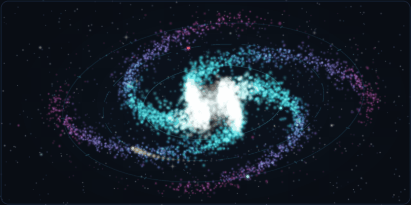

<!-- Galaxy visual system retained; portfolio content refreshed 2026-10-30. -->

  <picture>
    <source media="(prefers-color-scheme: dark)" srcset="assets/particle-galaxy.gif" />
    <source media="(prefers-color-scheme: light)" srcset="assets/particle-galaxy-light.gif" />
    
  </picture>

 

  <a href="https://git.io/typing-svg">
    <picture>
      <source media="(prefers-color-scheme: dark)" srcset="https://readme-typing-svg.demolab.com?font=JetBrains+Mono&weight=600&size=22&pause=1600&color=9CCFD8&center=true&vCenter=true&random=false&width=700&height=70&lines=independent+software+engineer+%C2%B7+nairobi;systems+%C2%B7+infrastructure+%C2%B7+products" />
      <source media="(prefers-color-scheme: light)" srcset="https://readme-typing-svg.demolab.com?font=JetBrains+Mono&weight=600&size=22&pause=1600&color=0E7490&center=true&vCenter=true&random=false&width=700&height=70&lines=independent+software+engineer+%C2%B7+nairobi;systems+%C2%B7+infrastructure+%C2%B7+products" />
      
    </picture>
  </a>

---

## ~/about

I build software across the stack — from storage engines and network protocols to data systems and products used in real businesses.

My work tends to focus on **correctness under failure, measurable performance, and useful engineering**: crash-safe storage, synchronization, concurrency, transport protocols, deterministic AI memory, developer tools, data pipelines, and payment-enabled applications.

**Primary languages:** Rust · C · Go · Python · TypeScript  
**Based in:** Nairobi, Kenya  
**Open to:** Remote engineering roles, contracts, and technically demanding collaborations.

---

## ~/selected-work

| Project | What it is | Evidence |
|:--|:--|:--|
| [**Cairn**](https://github.com/ssmurfgg04-gif/cairn) | Rust content-addressed storage and sync engine for professional video workflows. Chunking, hashing, durable local storage, synchronization, recovery, conflict handling, and media-workflow integration. | **1,253.8 MiB/s** FastCDC chunking; **859.4 MiB/s** ingest including per-chunk fsync; **5,028.7 MiB/s** single-threaded BLAKE3. |
| [**Context-M / cortexm**](https://github.com/ssmurfgg04-gif/context-m) | Local-first deterministic agent memory. No LLM calls at ingest or retrieval; structured recall, temporal reasoning, and BLAKE3-linked provenance. Published Python and npm packages. | **500/500** LongMemEval questions verifiable from retrieved context; **92.94%** on 1,444 comparable LoCoMo questions; **19 ms** median search latency. |
| [**C + io_uring server**](https://github.com/arjaythedev/twelve-dollar-server-challenge/pull/112) | Hand-written C HTTP service using Linux io_uring, SQLite, a direct listener, and an epoll fallback. | **150,000 simulated concurrent users** held for five minutes on the official 1-vCPU / 2-GB challenge machine; **14,611 req/s**, p95 **385 ms**, p99 **524 ms**, **0.00%** failed requests. |
| [**Helix Codec**](https://github.com/ssmurfgg04-gif/helix-codec) | TypeScript + Rust DNA archival codec: biological constraints, mutation simulation, and layered error correction for recovery from noisy sequencing reads. | Native Rust Viterbi path measured at **0.4 ms vs 850 ms** in one 1,000-read benchmark — a reported **2,000×** improvement over the JS path. |
| [**dsv**](https://github.com/ssmurfgg04-gif/dsv) | Rust command-line toolkit for CSV, TSV, Parquet, and JSONL; a modern extension of xsv. | On a 1-million-row dataset, up to **48% faster** on stats, **39%** on numeric sort, and **15%** on sort versus upstream xsv on the same machine. |
| [**Ledger POS**](https://github.com/ssmurfgg04-gif/pos-system) | White-label Go + React point-of-sale system for Kenyan retail: M-Pesa STK and callback flow, multi-shop isolation, dynamic RBAC, offline operation, inventory, customer credit, and ESC/POS printing. | Packaged as a single application binary; payment completion is gated on the provider callback and amount validation. |
| [**mappedclim**](https://github.com/ssmurfgg04-gif/mappedclim) | Geospatial data pipeline reverse-engineering a public coverage-gap benchmark using large map and census datasets. | Recorded **Top-4 public leaderboard** result; score **0.000003013**. |
| [**Jiji archival dataset**](https://github.com/ssmurfgg04-gif/jiji-wayback-dataset) | Historical African marketplace data mined from Common Crawl and Wayback archives, normalized and prepared for analysis. | **485,830** unique listings; **1,129,858** Common Crawl HTML captures parsed from **104,628** WARC bodies; **6,236** Wayback API captures. |

### More systems and research

[**Jiji Deal Hunter**](https://github.com/ssmurfgg04-gif/jiji-deal-hunter) — multi-market classifieds intelligence with archival collection, relist detection, entity and price signals, and XGBoost scoring.  
[**Vehicle Collateral Risk Engine**](https://github.com/ssmurfgg04-gif/vehicle-collateral-risk-engine-kenya) — graph-based entity resolution and fraud-risk research for vehicle-backed lending in Kenya.  
[**Bioelectric Cultivation**](https://github.com/ssmurfgg04-gif/bioelectric-cultivation) — falsification-first computational research using coupled dynamical systems, error correction, and large experiment sweeps.  
[**Startups.co.ke**](https://startups.co.ke) — a Kenyan startup ecosystem and business-intelligence platform.

---

## ~/upstream

I contribute fixes, integrations, and maintenance work to other projects. Selected examples:

- [**twelve-dollar-server-challenge #112**](https://github.com/arjaythedev/twelve-dollar-server-challenge/pull/112) — merged C/io_uring server submission; independently benchmarked by the challenge maintainer at 150,000 users.
- [**twelve-dollar-server-challenge #121**](https://github.com/arjaythedev/twelve-dollar-server-challenge/pull/121) — merged alternative C/libco server; scored at 71,000 users on the same official challenge hardware.
- [**awesome-deepseek-harness #524**](https://github.com/0xsline/awesome-deepseek-harness/pull/524) — merged integration of Context-M as a storage and session plugin.
- [**Atobold #1**](https://github.com/barryboy1002/Atobold0.0.2/pull/1) — merged code-review fixes covering build and boot robustness, VGA issues, serial debugging, exception reporting, tests, and CI.
- [**backend-br/desafios #164**](https://github.com/backend-br/desafios/pull/164) — merged C solution for a password-security challenge.

**Currently under review:** [Aether Protocol #1](https://github.com/nikaafo/aether-protocol/pull/1) fixes a UDP packet-routing race, an AEAD associated-data mismatch, and connection-close ordering; [mairix #43](https://github.com/rc0/mairix/pull/43) adds locale-independent Unicode case folding.

---

## ~/engineering-notes

Benchmarks are useful only with their conditions attached:

- **Cairn:** benchmarked on a shared 2-vCPU / 4-GB cloud container. The throughput figures are local release-build measurements, not WAN or production-cluster claims. [Method and results](https://github.com/ssmurfgg04-gif/cairn/blob/main/docs/BENCHMARKS.md).
- **Context-M:** the LongMemEval 500/500 result uses a deterministic rule-based judge to verify that gold answers are derivable from retrieved context. It is a retrieval-completeness result, **not** LLM-generated answer accuracy. LoCoMo uses the full ten-conversation corpus, 1,444 comparable questions, and retrieval depth k=60; this is not directly equivalent to Top-5 answer-generation evaluations. [Methodology and results](https://github.com/ssmurfgg04-gif/context-m).
- **C server:** the 150,000-user result is the challenge maintainer's scored five-minute run on a 1-vCPU / 2-GB VPS, not the larger self-run load-generator experiments. [Official leaderboard](https://github.com/arjaythedev/twelve-dollar-server-challenge/blob/main/LEADERBOARD.md).
- **dsv:** the xsv comparison is a local best-of-ten benchmark on an older 2-core laptop; the project documents it as a basic, noisy benchmark. [Full table and methodology](https://github.com/ssmurfgg04-gif/dsv/blob/master/BENCHMARKS.md).
- **mappedclim:** the Top-4 result is the public leaderboard result recorded in the repository; the write-up explains the reverse-engineered metric and remaining residual error.

I prefer reproducible measurements, explicit limitations, and a failing test over an impressive claim without evidence.

---

## ~/stack

  <a href="https://skillicons.dev">
    <picture>
      <source media="(prefers-color-scheme: dark)" srcset="https://skillicons.dev/icons?i=rust,c,go,py,ts,js,react,nodejs,linux,docker,sqlite,postgres,git,githubactions,cloudflare&perline=8&theme=dark" />
      <source media="(prefers-color-scheme: light)" srcset="https://skillicons.dev/icons?i=rust,c,go,py,ts,js,react,nodejs,linux,docker,sqlite,postgres,git,githubactions,cloudflare&perline=8&theme=light" />
      
    </picture>
  </a>

---

## ~/stats

  <a href="https://github.com/ssmurfgg04-gif">
    <picture>
      <source media="(prefers-color-scheme: dark)" srcset="https://raw.githubusercontent.com/ssmurfgg04-gif/ssmurfgg04-gif/output/stats-dark.svg" />
      <source media="(prefers-color-scheme: light)" srcset="https://raw.githubusercontent.com/ssmurfgg04-gif/ssmurfgg04-gif/output/stats-light.svg" />
      
    </picture>
  </a>
  <a href="https://github-readme-streak-stats.herokuapp.com/?user=ssmurfgg04-gif">
    <picture>
      <source media="(prefers-color-scheme: dark)" srcset="https://github-readme-streak-stats.herokuapp.com/?user=ssmurfgg04-gif&hide_border=true&background=0B0F1A&stroke=0B0F1A&ring=05D9E8&fire=FF2A6D&currStreakLabel=9CCFD8&sideLabels=6E6A86&currStreakNum=F6C177&sideNums=9CCFD8&dates=6E6A86" />
      <source media="(prefers-color-scheme: light)" srcset="https://github-readme-streak-stats.herokuapp.com/?user=ssmurfgg04-gif&hide_border=true&background=EAF0F6&stroke=EAF0F6&ring=0891B2&fire=FF2A6D&currStreakLabel=39516B&sideLabels=64748B&currStreakNum=D97706&sideNums=39516B&dates=64748B" />
      
    </picture>
  </a>

  <picture>
    <source media="(prefers-color-scheme: dark)" srcset="https://github-readme-stats.vercel.app/api/top-langs/?username=ssmurfgg04-gif&layout=compact&langs_count=8&hide_border=true&bg_color=0B0F1A&title_color=05D9E8&text_color=9CCFD8&icon_color=FF2A6D" />
    <source media="(prefers-color-scheme: light)" srcset="https://github-readme-stats.vercel.app/api/top-langs/?username=ssmurfgg04-gif&layout=compact&langs_count=8&hide_border=true&bg_color=EAF0F6&title_color=0891B2&text_color=39516B&icon_color=BE185D" />
    
  </picture>

---

## ~/snake

  <picture>
    <source media="(prefers-color-scheme: dark)" srcset="https://raw.githubusercontent.com/ssmurfgg04-gif/ssmurfgg04-gif/output/snake-dark.svg" />
    <source media="(prefers-color-scheme: light)" srcset="https://raw.githubusercontent.com/ssmurfgg04-gif/ssmurfgg04-gif/output/snake.svg" />
    
  </picture>
  Regenerated daily by <a href="https://github.com/ssmurfgg04-gif/ssmurfgg04-gif/blob/main/.github/workflows/snake.yml">snake.yml</a>

---

  <picture>
    <source media="(prefers-color-scheme: dark)" srcset="https://capsule-render.vercel.app/api?type=waving&color=0:05D9E8,50:7700FF,100:0B0F1A&height=90&section=footer" />
    <source media="(prefers-color-scheme: light)" srcset="https://capsule-render.vercel.app/api?type=waving&color=0:A5F3FC,50:BAE6FD,100:FFFFFF&height=90&section=footer" />
    
  </picture>

  
  
  
    
  Built in Nairobi. <a href="https://github.com/ssmurfgg04-gif">More work on GitHub →</a>

